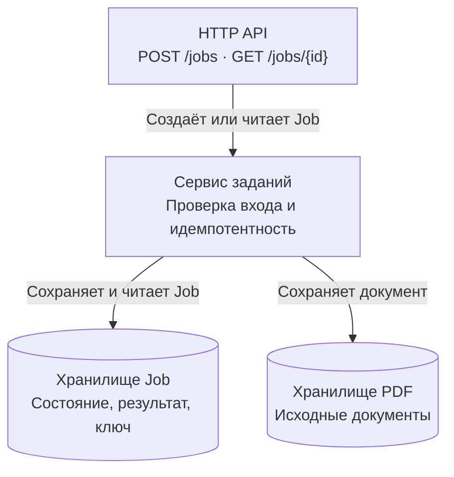
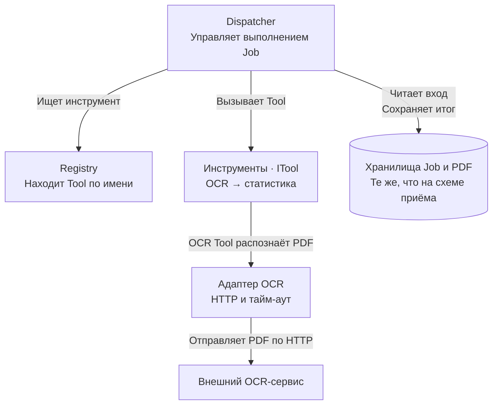
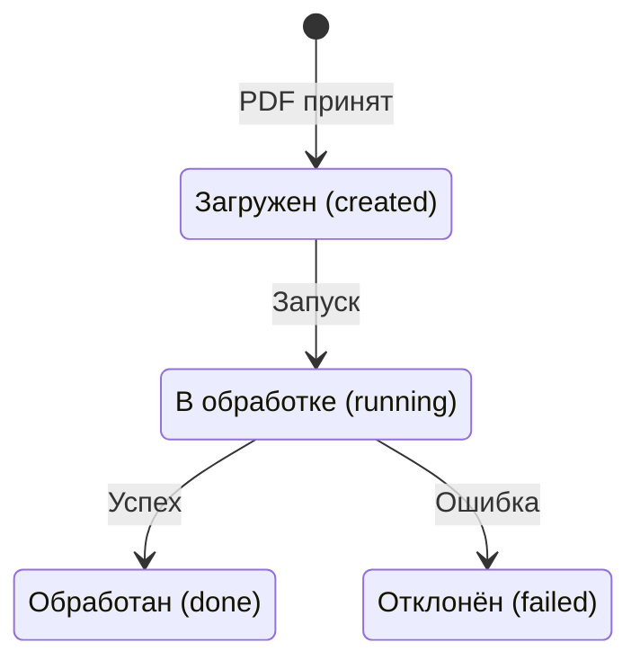

# Архитектура конвейера обработки документов

Схемы описывают проектируемую систему для P2. Основа поведения приведена в
[сценариях и жизненном цикле Job](requirements.md). Реализация доменного ядра
относится к P3.

## Контекст

Пользователь отправляет PDF и получает текст и статистику. Распознавание выполняет
внешний OCR-сервис, остальную работу берёт на себя наш конвейер.

Стрелки показывают вызовы от отправителя к получателю. Ответ возвращается
по тому же соединению. БД и файлы принадлежат нашей системе.

## Компоненты

В системе две части работы. Приём запроса создаёт Job и возвращает id.
Выполнение обрабатывает уже принятое задание. Они используют общие хранилища.
Ниже два представления компонентов одной системы.

### Приём запроса и чтение результата

Стрелки показывают вызовы компонентов. Сервис заданий проверяет вход,
сохраняет PDF и создаёт Job в `created`. При повторе с тем же ключом и входом
возвращает прежний id. GET читает сохранённое состояние без запуска обработки.

### Выполнение принятого задания

Стрелки показывают вызовы компонентов. Registry возвращает реализацию `ITool`;
Dispatcher вызывает её и получает `ToolResult`. OCR Tool возвращает текст,
Statistics Tool получает этот текст и возвращает число слов и символов.
Только OCR Tool обращается к адаптеру OCR.

При настройке приложения Dispatcher получает план конвейера, в котором заданы
имена Tool, порядок шагов и правила передачи данных между ними. План первой
версии задаёт OCR → статистика. Dispatcher исполняет план через Registry и ITool,
не содержит имён конкретных инструментов и не выбирает их классы. Чтобы включить
новый Tool в обработку, его регистрируют и обновляют план без изменения Dispatcher.

Dispatcher читает принятый Job из хранилища, переводит его в `running`,
выполняет OCR и подсчёт статистики, затем сохраняет результат и `done`
либо причину ошибки и `failed`. Правила смены состояния принадлежат сущности Job
и показаны отдельно на диаграмме состояний.

### Ответственность и границы компонентов

Границы исходного кода отличаются от направления этих вызовов. Job и правила
переходов находятся в Domain. Сервис заданий, Dispatcher, Registry и порты
хранилищ находятся в Application. Контракты Tool и OCR не зависят от HTTP-клиента,
ASP.NET Core или EF Core. Инфраструктурные адаптеры реализуют порты, а входной слой
связывает реализации при запуске. Доменное ядро не зависит от API, БД или файловой
системы.

| Компонент | За что отвечает | Что скрывает |
|---|---|---|
| HTTP API | Принимает запросы, оформляет ответы и единые ошибки | HTTP, ASP.NET Core и сериализацию |
| Сервис заданий | Проверяет вход, создаёт и читает Job, обрабатывает повторные запросы | Порядок проверки и сохранения входа |
| Dispatcher | Исполняет план через Registry и ITool, повторяет OCR при тайм-ауте, сохраняет исход Job | Обход шагов, передачу данных и обработку ошибок |
| Registry | Находит ITool по имени | Регистрацию и конкретные классы Tool |
| Job | Проверяет переходы состояния | Правила жизненного цикла |
| OCR Tool | Возвращает текст из PDF через ToolResult | Логику операции распознавания |
| Statistics Tool | Возвращает число слов и символов через ToolResult | Алгоритм подсчёта |
| Хранилище Job | Хранит состояния, результаты, причины ошибок и ключи | EF Core, SQL, SQLite → PostgreSQL |
| Хранилище PDF | Сохраняет и читает исходные документы | Пути и файловые операции |
| Адаптер OCR | Вызывает OCR, обрабатывает тайм-аут и некорректный ответ | Протокол и формат провайдера |

### Гарантии обработки

- До создания Job проверяется содержимое PDF, а не только расширение или
  `Content-Type`. При отказе задание не создаётся и OCR не вызывается.
- Один ключ и одинаковые байты PDF и параметры дают один Job, даже при
  одновременных запросах. Другой вход с тем же ключом даёт `409` без изменения
  прежнего задания. Успешный приём означает, что Job и исходный PDF сохранены.
- Приём запроса не ждёт OCR. Dispatcher сначала переводит Job в `running`,
  затем вызывает инструменты через Registry и ITool. Каждый Tool проверяет
  параметры своей операции и возвращает ToolResult.
- `done` сохраняется вместе с текстом и статистикой, `failed` вместе с причиной
  ошибки. Частичный результат не выдаётся как готовый. GET не запускает
  обработку; неизвестный id даёт `404` в едином формате ошибок.

Dispatcher работает в `BackgroundService` одного экземпляра приложения, получает
ожидающие задания из БД и атомарно переводит выбранный Job из `created`
в `running`. Очередь и восстановление описаны в [ADR-001][background-adr].
Порядок сохранения PDF и записи Job, а также компенсация при сбое БД описаны
в [ADR-002][storage-adr]. Оба ADR входят в
[PR #21](https://github.com/AIProgramIngeneering2026/team-slopworks/pull/21).

## Состояния Job

Стрелки показывают разрешённые изменения состояния одного Job. Начальная точка
обозначает создание, а не дополнительное состояние. `done` и `failed` являются
конечными состояниями; исходящих переходов у них нет.

| Состояние | Значение и доступные данные |
|---|---|
| `created` | PDF принят и сохранён, задание ожидает начала выполнения; готового результата нет. |
| `running` | Выполняются OCR и подсчёт статистики; готового результата ещё нет. |
| `done` | Конвейер завершён, сохранены и доступны текст и статистика. |
| `failed` | Выполнение остановлено, сохранена причина ошибки; готового результата нет. |

После первого тайм-аута Dispatcher повторяет вызов OCR Tool ровно один раз,
заново открывая исходный PDF для чтения с начала. Tool и адаптер не выполняют
собственных повторов. Job остаётся в `running`. Второй тайм-аут либо некорректный
ответ OCR приводит к `running → failed`. Ошибка Statistics Tool также завершает
Job через `failed`.
Невалидный запрос, отклонённый до создания, не является Job в состоянии `failed`.

При запуске приложения до начала обработки оставшиеся `running` переводятся
в `failed` с кодом `processing_interrupted`, как определено в
[ADR-001][background-adr]. Задания в `created` остаются в очереди.
Автоматического продолжения прерванного Job нет; для новой обработки нужен новый
ключ и новый Job. Это тот же переход `running → failed`, новые состояния
не добавляются.

### Запрещённые переходы и реакция системы

В таблице перечислены все пары состояний. «Отказ» означает отклонение команды
смены состояния; самопереход также не является допустимой командой.

| Из / в | `created` | `running` | `done` | `failed` |
|---|---|---|---|---|
| `created` | Отказ | Разрешён | Отказ | Отказ |
| `running` | Отказ | Отказ | Разрешён | Разрешён |
| `done` | Отказ | Отказ | Отказ | Отказ |
| `failed` | Отказ | Отказ | Отказ | Отказ |

При попытке запрещённого перехода Job возвращает вызывающему компоненту доменную
ошибку недопустимого перехода с текущим и запрошенным состоянием. Состояние,
результат и причина завершения остаются прежними. Dispatcher прекращает эту
попытку, не запускает инструменты и не перезаписывает сохранённый итог.
Конкурирующие изменения должны проверять ожидаемое текущее состояние при
сохранении, чтобы устаревшая запись не могла перезаписать завершённый Job.

Клиент не задаёт состояние напрямую через POST или GET. Изменение статуса,
отмена и повторный запуск того же Job не входят в эти операции API. Повтор
POST с прежним ключом и тем же входом возвращает прежний Job даже после его
завершения и не меняет состояние. Для новой обработки нужен новый ключ и новый
Job; прежний результат сохраняется.

HTTP-коды, поля запросов и тела ошибок определяются контрактом API в задаче
[#13](https://github.com/AIProgramIngeneering2026/team-slopworks/issues/13).
Контракт ITool / ToolResult и ADR относятся к задаче
[#14](https://github.com/AIProgramIngeneering2026/team-slopworks/issues/14).

[background-adr]: https://github.com/AIProgramIngeneering2026/team-slopworks/blob/7bc20d6cb2dd09a749597c38a338fe7e19c1c112/docs/adr/001-background-job-processing.md
[storage-adr]: https://github.com/AIProgramIngeneering2026/team-slopworks/blob/7bc20d6cb2dd09a749597c38a338fe7e19c1c112/docs/adr/002-data-and-file-storage.md
