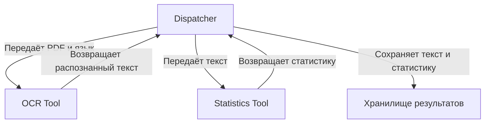

# Контракт Tool

## 1. Назначение

В сервисе обработка PDF разделена на отдельные этапы. Каждый этап выполняет свой инструмент (Tool):

1. **OCR Tool** — получает PDF-документ и возвращает распознанный текст.
2. **Statistics Tool** — получает текст и подсчитывает количество слов и символов.

Инструменты выполняют отдельные операции и не вызывают друг друга напрямую. Последовательностью этапов, обработкой результатов и сохранением итоговых данных управляет Dispatcher.

Этот контракт определяет правила взаимодействия Dispatcher с инструментами: входные и выходные данные, ограничения выполнения и формат ошибок.

## 2. Общие правила взаимодействия

Общие правила:

- Каждый Tool выполняет одну определённую операцию и имеет уникальное имя, по которому его можно найти в Registry.
- Входные и выходные данные типизированы; результат выполнения возвращается в формате `ToolResult<T>`.
- Tool проверяет корректность параметров своей операции, но не проверяет весь пользовательский запрос и не управляет бизнес-сценарием обработки Job.
- Tool не управляет состояниями Job, не обращается к HTTP API и хранилищу данных, не выбирает следующий этап, не определяет политику повторных попыток и не отвечает за идемпотентность пользовательских запросов.
- Для асинхронных операций используется `CancellationToken`.

### Кто за что отвечает

| Участник | Ответственность |
|---|---|
| Dispatcher | Передаёт входные данные, управляет порядком вызовов, отменой и политикой повторных попыток, обрабатывает результаты и сохраняет итоговые данные. |
| Tool | Проверяет параметры своей операции, выполняет её и возвращает результат или информацию об ошибке. |
| Registry | Находит зарегистрированный инструмент по имени и предоставляет его вызывающему компоненту. |

## 3. Общий интерфейс Tool

Каждый инструмент реализует базовый интерфейс `ITool` и предоставляет своё имя.

Для типизированного выполнения используется обобщённый интерфейс `ITool<TInput, TOutput>`.

Пример контракта на C#:

```csharp
public interface ITool
{
    string Name { get; }
}

public interface ITool<TInput, TOutput> : ITool
{
    Task<ToolResult<TOutput>> ExecuteAsync(
        TInput input,
        CancellationToken cancellationToken);
}
```

Здесь:

- `Name` — уникальное имя инструмента, используемое при регистрации и поиске.
- `TInput` — тип входных данных.
- `TOutput` — тип успешного результата.
- `ExecuteAsync` — асинхронный запуск операции.
- `CancellationToken` — механизм уведомления инструмента об отмене операции.

## 4. Формат результата ToolResult

Все инструменты возвращают результат в общем формате `ToolResult<T>`.

Результат может иметь только один из двух вариантов:

- **Успех** — операция выполнена, возвращены выходные данные.
- **Ошибка** — операция не выполнена, возвращена информация об ошибке.

Для результата ошибки используется `ToolError`:

| Поле | Назначение |
|---|---|
| `Code` | Стабильный код ошибки, по которому вызывающий компонент может определить её тип. |
| `Message` | Человекочитаемое описание произошедшей ошибки. |

Пример возможной структуры:

```csharp
public sealed record ToolError(
    string Code,
    string Message);

public abstract record ToolResult<T>
{
    private ToolResult() { }

    public sealed record Success(T Value)
        : ToolResult<T>;

    public sealed record Failure(ToolError Error)
        : ToolResult<T>;
}
```

Примеры использования:

```csharp
// Успешное выполнение
ToolResult<string> result =
    new ToolResult<string>.Success("Распознанный текст");

// Ошибка выполнения
ToolResult<string> error =
    new ToolResult<string>.Failure(
        new ToolError(
            "ocr_timeout",
            "Время ожидания ответа OCR-сервиса истекло."));
```

Формат `ToolResult<T>` не зависит от HTTP и не содержит `ProblemDetails`. Преобразование ошибок во внешний формат API выполняется на уровне соответствующего слоя приложения.

## 5. OCR Tool

### Назначение

OCR Tool отвечает за получение текста из PDF-документа с помощью OCR-механизма. Он скрывает от остальных компонентов особенности взаимодействия с OCR: формат вызова, используемый адаптер и особенности внешнего сервиса.

### Входные данные

```csharp
public sealed record OcrToolInput(
    Stream PdfStream,
    string Language);
```

| Поле | Назначение |
|---|---|
| `PdfStream` | Поток для чтения содержимого PDF-файла. |
| `Language` | Язык распознавания: `ru` или `en`. |

### Выходные данные

Успешный результат — строка с распознанным текстом.

```csharp
ITool<OcrToolInput, string>
```

Пустая строка допустима как результат успешного распознавания, если OCR не обнаружил текст. Это не считается ошибкой само по себе.

### Правила выполнения

- Tool принимает поток, а не путь к файлу. Поэтому ему не нужно знать, где и как хранится PDF.
- Dispatcher отвечает за открытие и закрытие потока.
- OCR Tool не закрывает переданный ему поток.
- Для каждой попытки распознавания Dispatcher открывает новый поток из файлового хранилища. Поток должен предоставлять содержимое PDF с самого начала.
- После завершения или неудачного выполнения попытки Dispatcher закрывает поток.
- Повторная попытка не должна зависеть от возможности перемотки ранее использованного потока.
- Язык распознавания должен быть одним из поддерживаемых значений: `ru` или `en`.

### Ошибки

Пример ошибки:

| Код | Значение |
|---|---|
| `ocr_timeout` | OCR не ответил в пределах установленного времени ожидания |
| `ocr_invalid_response` | OCR-сервис ответил, но ответ имеет некорректный или неподдерживаемый формат |
| `ocr_unavailable` | OCR-сервис недоступен или не может выполнить запрос |

Точный перечень ошибок и их соответствие ошибкам конкретного OCR-провайдера будут уточнены после выбора и интеграции OCR-решения.

### Повторные попытки

Политика повторных попыток принадлежит Dispatcher, а не OCR Tool.

При тайм-ауте OCR Dispatcher выполняет один повторный вызов. Перед каждой попыткой Dispatcher заново открывает PDF из файлового хранилища и передаёт новый поток в OCR Tool. После завершения каждой попытки поток закрывается.

Если обе попытки завершаются тайм-аутом, Job переводится в состояние `failed`.

Сам инструмент не принимает решение о повторном запуске и не управляет состоянием Job.

## 6. Statistics Tool

### Назначение

Statistics Tool получает распознанный текст и вычисляет его статистические характеристики. Он не зависит от OCR-провайдера и может работать с любой строкой, полученной на предыдущем этапе.

### Входные данные

```csharp
public sealed record StatisticsToolInput(
    string Text);
```

`Text` — текст, для которого необходимо вычислить статистику.

### Выходные данные

```csharp
public sealed record StatisticsToolOutput(
    long WordCount,
    long CharacterCount);
```

| Поле | Назначение |
|---|---|
| `WordCount` | Количество слов в тексте. |
| `CharacterCount` | Количество символов в тексте. |

### Правила подсчёта

Чтобы результат был одинаковым при любых реализациях инструмента, используются следующие определения:

- **Количество слов** — число непустых последовательностей символов, разделённых Unicode-пробельными символами.
- **Количество символов** — количество Unicode code points. Пробелы и символы перевода строки также учитываются.
- Пустой текст является допустимым входным значением. Для него оба показателя равны нулю.

### Ошибки

Statistics Tool возвращает ошибку, если не может выполнить вычисление. Специальные бизнес-ошибки для текущей операции не определены: подсчёт статистики не зависит от внешних сервисов и не требует доступа к хранилищу.

### Сохранение результата

Statistics Tool только вычисляет статистику и возвращает её вызывающему компоненту. Сохранение текста и статистики выполняет Dispatcher или соответствующий компонент хранения.

## 7. Взаимодействие инструментов в конвейере

Обработка одного Job выполняется последовательно:



1. Dispatcher получает PDF-поток из файлового хранилища и передаёт его вместе с языком распознавания в OCR Tool.
2. При успешном распознавании Dispatcher передаёт полученный текст в Statistics Tool.
3. После успешного завершения обоих этапов Dispatcher сохраняет текст и статистику и завершает Job со статусом `done`.
4. Если один из этапов завершается критической ошибкой, Dispatcher прекращает конвейер и обрабатывает её согласно правилам жизненного цикла Job.
